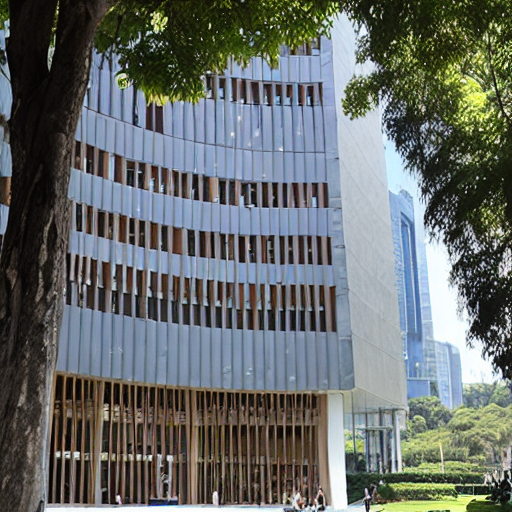
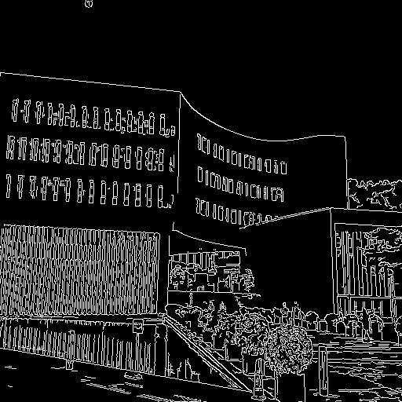

# Campus DreamBooth and ControlNet

校园建筑图像生成项目：自定义照片与 caption、Stable Diffusion 1.5 的 DreamBooth 风格 UNet 微调，以及 Canny ControlNet 条件推理。

## 主要实现

- `DreamBoothDataset` 将每张照片与手工 caption 对齐，完成缩放、裁剪、归一化与文本编码。
- 冻结 VAE 和文本编码器，使用 AdamW 与混合精度训练 UNet。
- 保存微调管线，并用 Canny 边缘图约束 ControlNet 推理。

## 训练记录

主文件是 [campus_dreambooth_controlnet.ipynb](notebooks/campus_dreambooth_controlnet.ipynb)。它来自作者的 `dreambooth_微调+canny.ipynb`，保留了原训练日志与图像输出。发布副本仅整理路径、CSV 表头读取和环境检查单元；这些输出是原始运行记录，没有重新训练。

| 参数 | 原始运行记录 |
| --- | --- |
| 图片尺寸 | 512 × 512 |
| batch size | 1 |
| 训练图片 | 47 张图书馆照片 |
| epochs | 30 |
| 更新次数 | 1,410 |
| optimizer | AdamW |
| learning rate | 5e-6 |
| 精度 | 混合精度 FP16 |
| 可训练模块 | UNet |

最后一个 epoch 的日志显示最后一个 batch 的 loss 为 0.00348；它不是整个数据集的平均 loss。

Notebook 中保存的是一张 DreamBooth 生成图和一张 Canny 条件图，最后一段 ControlNet 推理没有保存图像输出。`results/project_gallery` 保留项目期间独立导出的图片，不为缺少参数记录的图片补造实验标签。





## 数据集与目录

```text
data/raw/                 原始及补充校园照片
data/processed/library/   Notebook 使用的图书馆图片
data/processed/administration/ 行政楼图片
data/captions/            作者的 CSV、TXT 标注
docs/                    原始标注与项目说明文档
figures/                 项目使用的原理图
notebooks/               选出的主要训练 Notebook
results/                 Notebook 输出和独立项目图片
```

`data/captions/library.csv` 保存 51 条标注；主 Notebook 对应的已处理图片目录为 47 张，原始目录也保留了其它照片。历史 metadata 含有其它实验的文件名，保留用于追溯，不把它作为主 Notebook 的输入。详见 `data/dataset_summary.json`。

## 运行环境

在 GPU 环境安装 `requirements.txt`，从仓库根目录启动 Jupyter。准备完整的 Stable Diffusion 1.5 Diffusers 模型目录和 Canny ControlNet 模型目录，然后设置：

```bash
export CAMPUS_BASE_MODEL_DIR=/path/to/sd_v1.5
export CAMPUS_CONTROLNET_MODEL_DIR=/path/to/sd-controlnet-canny
export CAMPUS_FINETUNED_MODEL_DIR=/path/to/cuhksz_library_dreambooth
jupyter lab
```

Notebook 沿用原实验的本地模型读取方式。首次运行需要完整基础模型；训练后会保存微调目录。代码依赖 CUDA，不能据此声称已在 CPU 或当前电脑完成复现。

## 模型参数状态

截至 2026-10-11，在桌面、Documents 和 Downloads 的检查范围内，没有找到校园项目训练后的 UNet 或完整微调模型。原 Notebook 显示模型保存于远程训练环境。发现的本地 VAE 文件属于基础模型，不是本项目训练结果，因此没有把它作为微调参数上传。

## 来源

方法使用 DreamBooth、Stable Diffusion、ControlNet，以及 PyTorch、Hugging Face Diffusers/Transformers。项目原始文档和原理图保留在对应目录；第三方方法及图示的权利归原作者，本仓库未为这些材料额外授予许可证。
